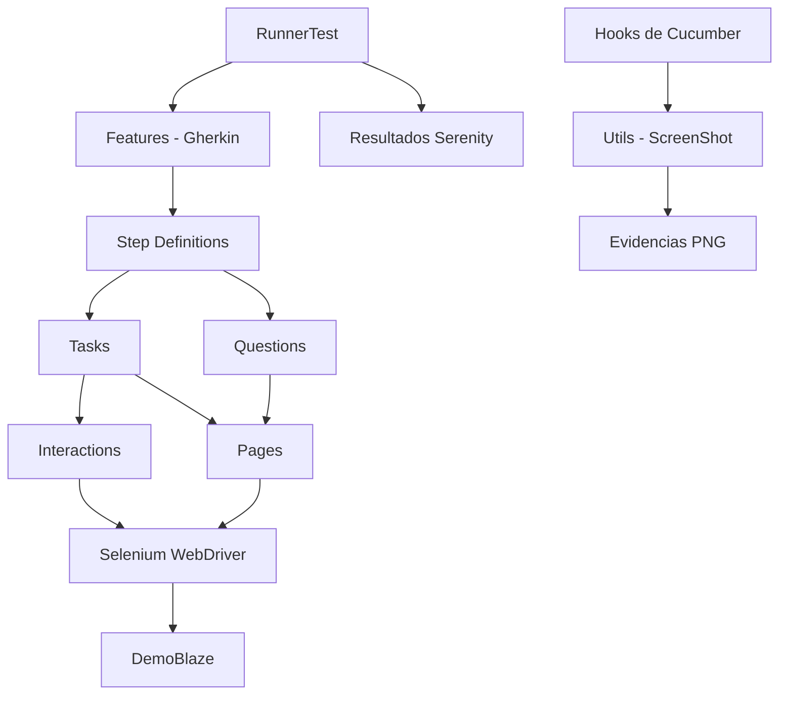
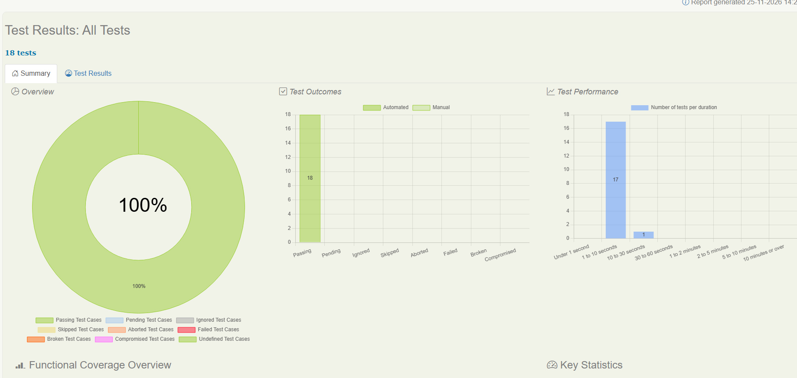
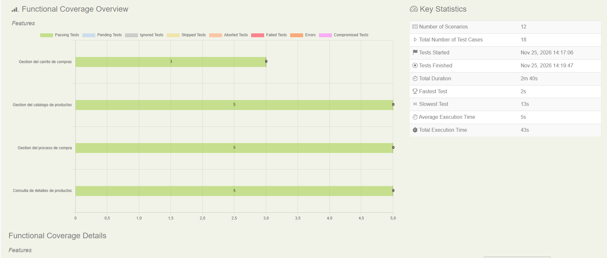
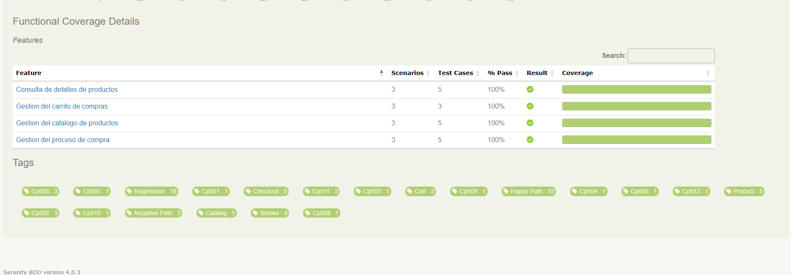

# DemoBlaze Automation Testing


## ELABORADO: 
```text
Frank jhoseph Duarte Oruro
```

## Descripción

Proyecto de automatización de pruebas funcionales web sobre [DemoBlaze](https://www.demoblaze.com/), una aplicación de comercio electrónico de demostración. 

La suite cubre la navegación por el catálogo, la consulta de detalles de productos, la gestión del carrito y el proceso de compra, mediante escenarios positivos y negativos expresados en Gherkin.

## Objetivos

- Automatizar flujos funcionales representativos de un comercio electrónico.
- Aplicar BDD y Screenplay para organizar pruebas reutilizables y mantenibles.
- Validar nombres, precios, productos, importes y mensajes de confirmación y error.
- Generar reportes de ejecución y evidencias visuales de forma automática.

## Tecnologías utilizadas

| Tecnología | Versión / propósito |
|---|---|
| Java | 17 |
| Maven | Gestión de dependencias y ejecución |
| Serenity BDD | 4.0.3 |
| Selenium WebDriver | 4.12.1 |
| Cucumber | 7.13.0 — escenarios Gherkin |
| JUnit | 4.13.2 — ejecución de pruebas |
| Screenplay | Patrón de automatización |
| Hamcrest | Validaciones y aserciones |
| IntelliJ IDEA | Entorno de desarrollo |
| Google Chrome | Navegador validado |

## Cobertura funcional

| Feature | Escenarios | Casos de prueba | Exitosos |
|---|---:|---:|---:|
| Catálogo de productos | 3 | 5 | 5 |
| Detalles de productos | 3 | 5 | 5 |
| Carrito de compras | 3 | 3 | 3 |
| Proceso de compra | 3 | 5 | 5 |
| **Total** | **12** | **18** | **18** |

### Casos de prueba

| ID | Feature | Escenario | Ejecuciones | Tipo |
|---|---|---|---:|---|
| CP001 | Catálogo | Visualizar el catálogo de productos | 1 | Happy Path |
| CP002 | Catálogo | Filtrar productos por categoría | 3 | Happy Path |
| CP003 | Catálogo | Navegar entre las páginas del catálogo | 1 | Happy Path |
| CP004 | Detalles | Acceder al detalle de un producto | 1 | Happy Path |
| CP005 | Detalles | Validar nombre y precio de diferentes productos | 3 | Happy Path |
| CP006 | Detalles | Validar descripción, imagen y botón Add to cart | 1 | Happy Path |
| CP007 | Carrito | Agregar un producto al carrito | 1 | Happy Path |
| CP008 | Carrito | Eliminar un producto del carrito | 1 | Happy Path |
| CP009 | Carrito | Validar el precio total de varios productos | 1 | Happy Path |
| CP010 | Compra | Realizar una compra exitosa | 1 | Happy Path |
| CP011 | Compra | Intentar comprar sin completar campos obligatorios | 3 | Negative Path |
| CP012 | Compra | Validar el importe de la confirmación de compra | 1 | Happy Path |

Los escenarios CP002, CP005 y CP011 utilizan `Scenario Outline`, por lo que cada fila de `Examples` genera una ejecución independiente. Los datos de compra son ficticios y se utilizan exclusivamente con fines de prueba.

## Arquitectura Screenplay

El proyecto separa las responsabilidades de la automatización en componentes reutilizables:

| Componente | Responsabilidad |
|---|---|
| Pages | Definición de locators de la interfaz web mediante ID, XPath y CSS Selector. |
| Tasks | Acciones de negocio ejecutadas por el actor. |
| Interactions | Operaciones específicas, como el manejo de alertas JavaScript. |
| Questions | Consultas y validaciones del estado de la aplicación. |
| Utils | Parámetros y herramientas de captura de evidencias. |
| Step Definitions | Conexión entre los pasos Gherkin y los componentes Screenplay. |
| Hooks | Preparación de escenarios y captura automática de evidencias. |
| Runner | Configuración de la ejecución con Cucumber y Serenity. |



## Estructura del proyecto

```text
DemoBlazeAutomation/
├── evidencias/                       # Capturas PNG generadas en ejecución
├── src/
│   ├── main/
│   │   └── java/org/example/
│   │       ├── interactions/
│   │       │   ├── AcceptCartAlert.java
│   │       │   └── AcceptCheckoutAlert.java
│   │       ├── pages/
│   │       │   ├── HomePage.java
│   │       │   ├── ProductPage.java
│   │       │   ├── CartPage.java
│   │       │   └── CheckoutPage.java
│   │       ├── questions/
│   │       │   ├── CatalogQuestion.java
│   │       │   ├── ProductQuestion.java
│   │       │   ├── CartQuestion.java
│   │       │   └── CheckoutQuestion.java
│   │       ├── tasks/
│   │       │   ├── NavigateHome.java
│   │       │   ├── NavigateCatalog.java
│   │       │   ├── SelectCategory.java
│   │       │   ├── SelectProduct.java
│   │       │   ├── AddToCart.java
│   │       │   ├── NavigateCart.java
│   │       │   ├── RemoveFromCart.java
│   │       │   ├── OpenCheckout.java
│   │       │   ├── FillPurchaseForm.java
│   │       │   └── ConfirmPurchase.java
│   │       └── utils/
│   │           ├── Parameters.java
│   │           └── ScreenShot.java
│   └── test/
│       ├── java/org/example/
│       │   ├── runner/
│       │   │   └── RunnerTest.java
│       │   └── stepdefinitions/
│       │       ├── ParameterDefinition.java
│       │       ├── PreAndProsCondition.java
│       │       ├── CommonSteps.java
│       │       ├── CatalogSteps.java
│       │       ├── ProductSteps.java
│       │       ├── CartSteps.java
│       │       └── CheckoutSteps.java
│       └── resources/
│           ├── features/
│           │   ├── catalog.feature
│           │   ├── product.feature
│           │   ├── cart.feature
│           │   └── checkout.feature
│           └── serenity.conf
├── target/                           # Archivos generados por Maven
├── pom.xml
├── .gitignore
└── README.md
```

## Requisitos previos

- JDK 17.
- Apache Maven disponible en el PATH, o Maven integrado en IntelliJ IDEA.
- Google Chrome instalado.
- Conexión a Internet para acceder a DemoBlaze y descargar dependencias y controladores cuando corresponda.
- Git (opcional, para clonar el repositorio).

## Instalación y ejecución

Descargar o clonar este repositorio desde GitHub y abrir la carpeta `DemoBlazeAutomation` como proyecto Maven en IntelliJ IDEA. Configurar JDK 17 y permitir que Maven descargue las dependencias declaradas en `pom.xml`.

### Compilar el proyecto

```bash
mvn clean test-compile
```

### Ejecutar la suite completa

```bash
mvn clean verify
```


### Ejecutar desde IntelliJ IDEA

Abrir `src/test/java/org/example/runner/RunnerTest.java` y seleccionar **Run 'RunnerTest'**. Esta alternativa permite ejecutar las pruebas durante el desarrollo, aunque no reemplaza la fase de generación del reporte completo de Maven.

### Ejecutar por etiquetas

```bash
mvn clean verify "-Dcucumber.filter.tags=@Smoke"
mvn clean verify "-Dcucumber.filter.tags=@Cart"
mvn clean verify "-Dcucumber.filter.tags=@NegativePath"
mvn clean verify "-Dcucumber.filter.tags=@CP012"
```

| Etiqueta | Propósito |
|---|---|
| `@Regression` | Suite de regresión |
| `@Smoke` | Validaciones principales |
| `@HappyPath` | Escenarios positivos |
| `@NegativePath` | Escenarios negativos |
| `@Catalog`, `@Product`, `@Cart`, `@Checkout` | Selección por funcionalidad |
| `@CP001` a `@CP012` | Selección por escenario |

## Reporte Serenity BDD

Al ejecutar `mvn clean verify`, el reporte se genera en:

```text
target/site/serenity/index.html
```

Abrir el archivo `index.html` en un navegador para consultar estadísticas, cobertura funcional, resultados por escenario, tiempos y capturas de pantalla. La carpeta `target/` se genera localmente y no necesita versionarse.
### Capturas del reporte Serenity BDD






## Evidencias automáticas

Además de las capturas integradas en Serenity, el proyecto utiliza Hooks de Cucumber y Selenium `TakesScreenshot` para guardar imágenes PNG independientes en la carpeta [`evidencias/`](evidencias/).

- `@Before`: crea una carpeta por cada caso de prueba con fecha, hora y nombre del escenario.
- `@AfterStep`: intenta capturar la pantalla después de cada paso Gherkin.
- Las capturas se numeran por paso; cuando existe una alerta JavaScript activa, la captura se omite para no interferir con su manejo.
- Las incidencias de captura se registran en consola sin convertir por sí solas una prueba funcional exitosa en fallida.

Ejemplo de estructura generada:

```text
evidencias/
└── fecha_hora_Acceder al detalle de un producto/
    ├── evidencia_fecha_hora_Paso1.png
    ├── evidencia_fecha_hora_Paso2.png
    └── evidencia_fecha_hora_Paso3.png
```

Cada ejecución añade nuevas carpetas. Para conservar únicamente las evidencias de una ejecución definitiva, guardar primero cualquier evidencia que se necesite y limpiar las anteriores desde PowerShell, en la raíz del proyecto:


## Defecto funcional identificado

**BUG-001 — Paginación incorrecta al regresar a la primera página del catálogo**

| Campo | Detalle |
|---|---|
| Módulo | Catálogo |
| Caso relacionado | CP003 |
| Estado | Reproducido manualmente |
| Severidad propuesta | Media |
| Prioridad propuesta | Media |
| Resultado esperado | Recuperar los mismos nueve productos de la primera página al avanzar con Next y regresar con Previous. |
| Resultado observado | Samsung galaxy s6 desaparece y Apple monitor 24 aparece en su lugar. |


## Buenas prácticas y alcance

- Separación de responsabilidades mediante Screenplay.
- Reutilización de Tasks, Questions y locators dinámicos.
- Esperas explícitas para elementos y alertas, sin esperas fijas `Thread.sleep()` en los flujos implementados.
- Escenarios parametrizados mediante `Scenario Outline`.
- Uso de etiquetas para organizar las pruebas.
- Generación automática de reportes y evidencias.
- Chrome es el navegador verificado. Edge y Firefox no forman parte de los resultados comprobados.
- Las pruebas dependen de una aplicación externa de demostración, por lo que cambios de datos, disponibilidad o comportamiento del sitio pueden afectar futuras ejecuciones.

## Autoría

Proyecto académico desarrollado durante la capacitación de QA Automation, con fines de aprendizaje y portafolio profesional.

---

**DemoBlaze Automation Testing | Java · Selenium · Serenity BDD · Cucumber · Screenplay**
